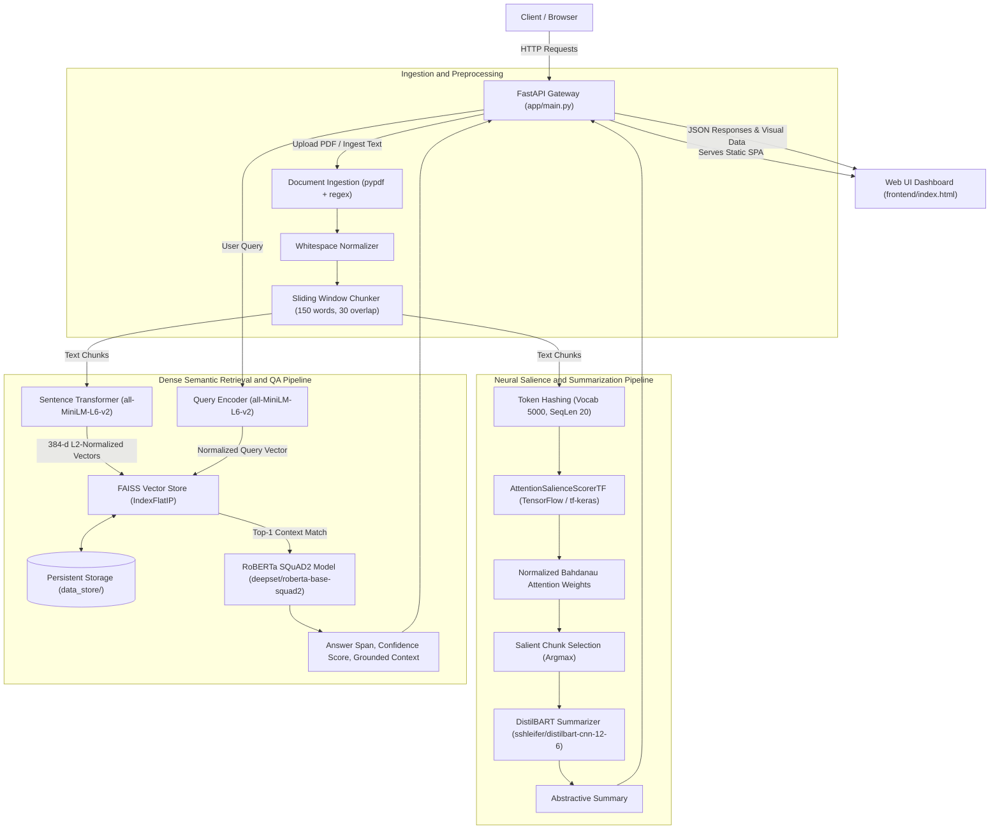
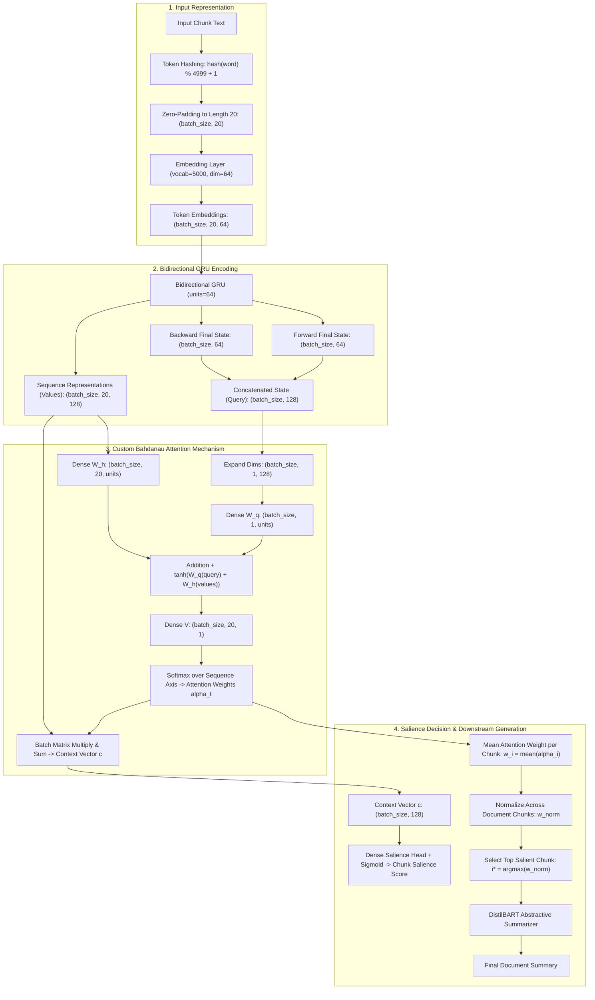

# DeepDigest

DeepDigest is a neural document intelligence engine that combines custom deep learning architectures with transformer inference pipelines. It performs automated PDF text extraction, document chunking, attention-based salience scoring for abstractive summarization, and dense semantic retrieval for extractive question answering.

The system is designed with a dual-framework architecture: a custom Bidirectional Gated Recurrent Unit (Bi-GRU) model featuring Bahdanau Additive Attention built on TensorFlow and tf-keras for neural salience computation, coupled with PyTorch-based Hugging Face transformers for sequence-to-sequence summarization and extractive question answering.

---

## Key Capabilities

- Document Ingestion and Cleaning: Extracts raw textual content from PDF files and plain text streams using pypdf and regex-based normalization.
- Sliding Window Chunking: Segments long-form documents into semantic windows with configurable word size and overlap to preserve local context.
- Custom Bahdanau Attention Salience: Evaluates token-level and chunk-level relevance using a trained recurrent attention network, identifying the single most informative chunk in the document.
- Abstractive Document Summarization: Uses the DistilBART model to generate concise, abstractive summaries grounded on the most salient text passage.
- Dense Vector Indexing with FAISS: Encodes document chunks into 384-dimensional dense semantic vectors using all-MiniLM-L6-v2, indexed via normalized inner-product search (IndexFlatIP) with JSON sidecar persistence.
- Extractive Question Answering: Retrieves relevant context using cosine similarity and pinpoints precise answer spans with confidence scores using RoBERTa fine-tuned on SQuAD 2.0.
- Interactive Web Interface: Single-page application built with Tailwind CSS and Chart.js providing real-time attention weight visualization and live question answering.
- Production Ready Deployment: Containerized with Docker and Docker Compose, including model pre-caching, health checks, and GitHub Actions CI/CD publishing to GitHub Container Registry (GHCR).

---

## System Architecture Diagram

The diagram below illustrates the end-to-end data flow and interactions between the frontend, API gateway, core processing pipelines, deep learning models, and persistent storage.



### System Workflow Description

1. Ingestion: The user uploads a PDF file via `/upload` or submits raw text via `/ingest_text`. Text is extracted via pypdf, cleaned of irregular whitespaces, and divided into sliding-window chunks (150 words per chunk with 30-word overlap).
2. Salience Scoring: Chunks are tokenized into integer IDs and passed to the custom TensorFlow `AttentionSalienceScorerTF` model. The network computes Bahdanau attention weights across token states. Chunk-level weights are averaged and normalized to produce a document-level attention distribution.
3. Summarization: The chunk with the highest attention weight is routed to `sshleifer/distilbart-cnn-12-6` to produce an abstractive summary.
4. Semantic Search and Storage: During ingestion, all chunks are embedded into 384-dimensional dense vectors using `sentence-transformers/all-MiniLM-L6-v2`. Embeddings are L2-normalized and stored in a FAISS `IndexFlatIP` index, with text metadata saved to disk.
5. Extractive QA: When a user query arrives at `/ask`, the question is embedded and compared against indexed chunks using cosine similarity. The highest-ranked chunk is provided alongside the query to `deepset/roberta-base-squad2`, which extracts the exact answer span and associated confidence score.

---

## Model Working Architecture

DeepDigest incorporates two distinct model workflows: a custom neural salience network built using recurrent layers and additive attention, and a dual-transformer pipeline for representation and generation.



### Mathematical Foundations of Bahdanau Salience

#### 1. Input Embedding and Bidirectional Recurrence
Given a sequence of token IDs $\mathbf{x} = [x_1, x_2, \dots, x_T]$ with sequence length $T = 20$:
$$\mathbf{e}_t = \text{Embedding}(x_t) \in \mathbb{R}^{d_e}, \quad d_e = 64$$

The Bidirectional GRU processes $\mathbf{e}_t$ in both forward and backward directions:
$$\overrightarrow{\mathbf{h}}_t = \overrightarrow{\text{GRU}}(\mathbf{e}_t, \overrightarrow{\mathbf{h}}_{t-1})$$
$$\overleftarrow{\mathbf{h}}_t = \overleftarrow{\text{GRU}}(\mathbf{e}_t, \overleftarrow{\mathbf{h}}_{t+1})$$

The sequence outputs $\mathbf{h}_t$ and query state $\mathbf{s}$ are formed by concatenating the representations:
$$\mathbf{h}_t = [\overrightarrow{\mathbf{h}}_t \,;\, \overleftarrow{\mathbf{h}}_t] \in \mathbb{R}^{2 u}, \quad u = 64$$
$$\mathbf{s} = [\overrightarrow{\mathbf{h}}_T \,;\, \overleftarrow{\mathbf{h}}_1] \in \mathbb{R}^{2 u}$$

#### 2. Bahdanau Additive Attention Alignment
The attention score $e_t$ measures the compatibility of each token position $t$ with the global recurrent state $\mathbf{s}$:
$$e_t = \mathbf{V}^T \tanh(\mathbf{W}_q \mathbf{s} + \mathbf{W}_h \mathbf{h}_t)$$
where $\mathbf{W}_q \in \mathbb{R}^{u \times 2u}$, $\mathbf{W}_h \in \mathbb{R}^{u \times 2u}$, and $\mathbf{V} \in \mathbb{R}^{u \times 1}$.

Attention weights $\alpha_t$ are obtained via the softmax activation over the sequence length:
$$\alpha_t = \frac{\exp(e_t)}{\sum_{k=1}^T \exp(e_k)}, \quad \sum_{t=1}^T \alpha_t = 1$$

The context vector $\mathbf{c}$ represents the alignment-weighted sum:
$$\mathbf{c} = \sum_{t=1}^T \alpha_t \mathbf{h}_t \in \mathbb{R}^{2 u}$$

The salience probability score $\hat{y}$ is generated through a sigmoid output head:
$$\hat{y} = \sigma(\mathbf{W}_s \mathbf{c} + b_s) \in [0, 1]$$

#### 3. Chunk-Level Salience Aggregation
For each chunk $i \in \{1, \dots, N\}$, the average token attention weight is computed:
$$w_i = \frac{1}{T} \sum_{t=1}^T \alpha_{i, t}$$

The document-level attention distribution is normalized across all chunks:
$$\bar{w}_i = \frac{w_i}{\sum_{j=1}^N w_j}$$

The chunk with maximum attention mass is selected as the primary context for summarization:
$$i^* = \arg\max_{i \in \{1, \dots, N\}} \bar{w}_i$$

#### 4. Semantic Retrieval and Question Answering
- Embedding: Each chunk $C_i$ is mapped to a 384-dimensional vector using `all-MiniLM-L6-v2`:
  $$\mathbf{v}_i = \text{Embed}(C_i), \quad \hat{\mathbf{v}}_i = \frac{\mathbf{v}_i}{\|\mathbf{v}_i\|_2}$$
- Query Retrieval: Given user question $Q$, its normalized embedding $\hat{\mathbf{q}}$ is compared against all chunks in FAISS using Inner Product (equivalent to cosine similarity under L2 normalization):
  $$\text{sim}(Q, C_i) = \hat{\mathbf{q}} \cdot \hat{\mathbf{v}}_i$$
  $$C_{\text{retrieved}} = \arg\max_i \text{sim}(Q, C_i)$$
- Span Extraction: The retrieved context $C_{\text{retrieved}}$ and question $Q$ are fed into `roberta-base-squad2` to compute start and end logits for the candidate span:
  $$P(\text{start} = j) = \text{softmax}(l_{j}^{\text{start}}), \quad P(\text{end} = k) = \text{softmax}(l_{k}^{\text{end}})$$
  $$\text{Span}^* = \arg\max_{j \le k} P(\text{start} = j) \cdot P(\text{end} = k)$$

---

## Directory Structure

```
DeepDigest/
|-- .github/
|   `-- workflows/
|       `-- ci-cd-ghcr.yml        # Automated testing and GHCR container build workflow
|-- app/
|   |-- __init__.py               # Application package initializer
|   |-- dl_models.py              # Custom Bahdanau Attention & Bi-GRU Salience Scorer (TensorFlow)
|   |-- main.py                   # FastAPI REST API endpoints, CORS configuration, and app lifecycle
|   |-- pipeline.py               # End-to-end orchestration pipeline (Extraction, Attention, QA, Summary)
|   `-- vector_store.py           # Persistent FAISS IndexFlatIP vector store with JSON metadata sidecar
|-- data_store/
|   |-- deepdigest.index          # Serialized FAISS vector index binary
|   `-- metadata.json             # Serialized document chunks and mapping metadata
|-- frontend/
|   `-- index.html                # Single-page interface with Tailwind CSS and Chart.js visualization
|-- scripts/
|   `-- evaluate_models.py        # Accuracy, entropy, and QA extraction benchmark test suite
|-- tests/
|   |-- __init__.py               # Test package initializer
|   `-- test_api.py               # Automated pytest suite for FastAPI endpoints and pipeline flows
|-- .dockerignore                 # Excluded build artifacts for Docker context optimization
|-- .gitignore                    # Ignored directories, caches, environments, and binary files
|-- Dockerfile                    # Multi-stage production container definition with model pre-caching
|-- docker-compose.yml            # Docker Compose orchestration definition for one-command deployment
|-- Readme.md                     # Comprehensive technical documentation
`-- requirements.txt              # Pinned Python package dependencies aligned for Python 3.12
```

---

## API Reference

The DeepDigest backend provides interactive OpenAPI documentation available at `/docs` or `/redoc` when the server is running.

### 1. Health Check
- Method: `GET`
- Endpoint: `/health`
- Description: Verifies backend server health and deployment readiness.
- Response:
```json
{
  "status": "healthy",
  "service": "DeepDigest",
  "version": "1.0.0"
}
```

### 2. Web Interface
- Method: `GET`
- Endpoint: `/`
- Description: Serves the single-page application dashboard located in `frontend/index.html`.

### 3. Document Upload
- Method: `POST`
- Endpoint: `/upload`
- Content-Type: `multipart/form-data`
- Parameters:
  - `file`: PDF file to ingest (required).
- Response:
```json
{
  "filename": "document.pdf",
  "word_count": 1420,
  "message": "Successfully parsed document.pdf (1420 words)."
}
```

### 4. Text Ingestion
- Method: `POST`
- Endpoint: `/ingest_text`
- Content-Type: `application/x-www-form-urlencoded`
- Parameters:
  - `text`: Plain text string to parse and index (required).
  - `filename`: Optional document identifier label (default: `direct_text.txt`).
- Response:
```json
{
  "filename": "direct_text.txt",
  "word_count": 350,
  "status": "stored"
}
```

### 5. Salience Scoring and Summarization
- Method: `POST`
- Endpoint: `/summarize`
- Description: Executes the forward pass through the TensorFlow Bahdanau attention model across all chunks, returns the attention distribution, and summarizes the highest-weighted chunk with DistilBART.
- Response:
```json
{
  "filename": "document.pdf",
  "summary": "Recurrent neural networks face vanishing gradient issues. Bahdanau additive attention computes dynamic alignment vectors to mitigate sequence bottlenecks.",
  "salient_chunk_index": 1,
  "attention_distribution": [0.2451, 0.4812, 0.2737]
}
```

### 6. Question Answering
- Method: `POST`
- Endpoint: `/ask`
- Content-Type: `application/x-www-form-urlencoded`
- Parameters:
  - `question`: Natural language inquiry to evaluate (required).
- Response:
```json
{
  "question": "What non-linearity is used in Bahdanau attention?",
  "answer": "hyperbolic tangent",
  "confidence": 0.8842,
  "context": "The Bahdanau additive attention layer computes alignment scores using a learned feedforward network parameterized by weight matrices and a hyperbolic tangent non-linearity."
}
```

---

## Installation and Local Setup

### Prerequisites
- Python 3.12 (standard 64-bit release)
- Git
- C++ build tools (required for compiling native FAISS wheels on some platforms)

### Setup Instructions

1. Clone the repository:
```bash
git clone https://github.com/your-username/DeepDigest.git
cd DeepDigest
```

2. Create and activate a Python virtual environment:
```bash
# On Linux / macOS:
python3.12 -m venv venv
source venv/bin/activate

# On Windows (PowerShell):
python -m venv venv
.\venv\Scripts\Activate.ps1
```

3. Install pinned dependencies:
```bash
pip install --upgrade pip
pip install -r requirements.txt
```

4. Launch the local FastAPI application server:
```bash
uvicorn app.main:app --host 0.0.0.0 --port 8000 --reload
```
Open `http://localhost:8000` in your browser to access the dashboard.

---

## Testing and Benchmarks

### Executing Unit and Integration Tests
The repository includes a comprehensive test suite using pytest to validate endpoint responses, error conditions, and pipeline execution.

```bash
pytest -v
```

### Running Model Benchmarks and Accuracy Verification
DeepDigest provides a dedicated benchmark script (`scripts/evaluate_models.py`) that tests:
- Sliding-window chunking consistency
- Bahdanau attention weight distribution properties ($\sum \alpha = 1.0$)
- Attention entropy calculations
- Abstractive summary length constraints
- FAISS cosine similarity retrieval score thresholds
- RoBERTa contextual question answering accuracy across sample technical queries

To execute the benchmark:
```bash
python scripts/evaluate_models.py
```

Expected benchmark output format:
```
=================================================================
      DEEPDIGEST ENGINE: LOCAL ACCURACY & BENCHMARK SUITE     
=================================================================

[1/4] Initializing TF pipeline & transformer weights...
      Model loaded successfully.

[2/4] Testing Ingestion & FAISS Semantic Indexing...
      Total Chunks: 3 | Total Words: 215
      FAISS index initialized with normalized vectors.

[3/4] Evaluating Bi-GRU + Bahdanau Attention Salience...
      Attention Distribution: [0.3124, 0.4592, 0.2284]
      Sum of Weights: 1.000000 (Must equal 1.0)
      Salience Entropy: 1.0421
      Top Salient Chunk Index: 1
      Abstractive Summary: "Traditional recurrent neural networks struggle with long-range..."
      Bahdanau attention layer mathematically sound.

[4/4] Evaluating FAISS Retrieval & RoBERTa QA Extraction...
      Test Q1: "What causes traditional RNNs to struggle with long-range dependencies?"
      -> Retrieved Similarity: 0.8124
      -> RoBERTa Answer: "vanishing and exploding gradient problems" (Confidence: 89.14%)
      -> Groundedness Check: PASS

=================================================================
      ACCURACY VERDICT: 3/3 (100.0%) QA Tests Passed
=================================================================
```

---

## Docker and Container Deployment

### Standalone Docker Execution

1. Build the Docker container image:
```bash
docker build -t deepdigest:latest .
```
Note: During the build stage, the Dockerfile pre-caches `all-MiniLM-L6-v2`, `distilbart-cnn-12-6`, and `roberta-base-squad2` inside `/root/.cache/huggingface`, preventing runtime download delays and enabling offline execution.

2. Run the container:
```bash
docker run -d --name deepdigest-container -p 8000:8000 deepdigest:latest
```

3. Validate container health:
```bash
curl http://localhost:8000/health
```

### Docker Compose Deployment
To run the service using Docker Compose:

```bash
docker compose up -d --build
```

The application will be accessible at `http://localhost:8080` (mapped to internal container port 8000).

To view runtime container logs:
```bash
docker compose logs -f
```

To stop the service:
```bash
docker compose down
```

---

## Continuous Integration and Delivery (CI/CD)

The repository includes a GitHub Actions configuration file at `.github/workflows/ci-cd-ghcr.yml`. The automated workflow consists of two stages:

1. Continuous Integration (`ci-test`):
   - Triggers on push or pull request to `main` and `master` branches.
   - Sets up Python 3.12 on an Ubuntu runner.
   - Installs system libraries and pinned Python dependencies.
   - Executes the full test suite via `pytest -v`.

2. Continuous Delivery (`cd-ghcr`):
   - Executes only upon successful test passage on main branch pushes or version tags (`v*.*.*`).
   - Authenticates to the GitHub Container Registry (`ghcr.io`).
   - Builds the production Docker image using Docker Buildx and GitHub Actions layer caching.
   - Pushes tagged Docker images to `ghcr.io/<repository-owner>/deepdigest`.

---

## Technical Specifications and Compatibility

| Component | Specification / Version | Role |
| :--- | :--- | :--- |
| Runtime Platform | Python 3.12 (64-bit) | Application execution runtime |
| Deep Learning Core | TensorFlow 2.16.1 / tf-keras 2.16.0 | Custom Bi-GRU and Bahdanau attention layer |
| ABI Alignment | NumPy 1.26.4 / Protobuf 4.25.3 | C-extension ABI stability for TensorFlow 2.16 |
| Sentence Embeddings | sentence-transformers 2.7.0 (`all-MiniLM-L6-v2`) | 384-dimensional dense semantic vectors |
| Vector Index | FAISS-CPU 1.8.0 (`IndexFlatIP`) | Normalized inner-product cosine similarity retrieval |
| Summarization Model | Hugging Face PyTorch (`sshleifer/distilbart-cnn-12-6`) | Abstractive sequence-to-sequence summarization |
| Question Answering Model | Hugging Face PyTorch (`deepset/roberta-base-squad2`) | Extractive contextual span localization |
| Document Extraction | pypdf 4.2.0 | PDF binary stream parsing and character extraction |
| Web API Framework | FastAPI 0.111.0 / Uvicorn 0.29.0 | Asynchronous REST service and static asset host |
| Web Presentation | HTML5, Tailwind CSS, Chart.js | Interactive dashboard and attention distribution chart |
